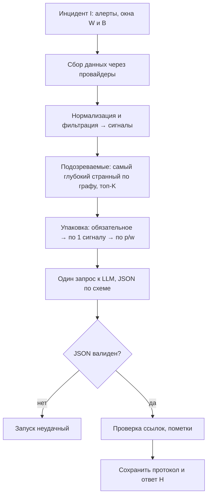
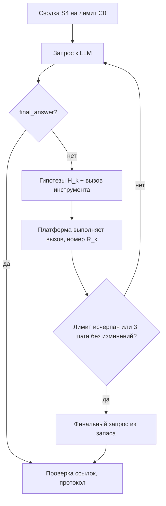
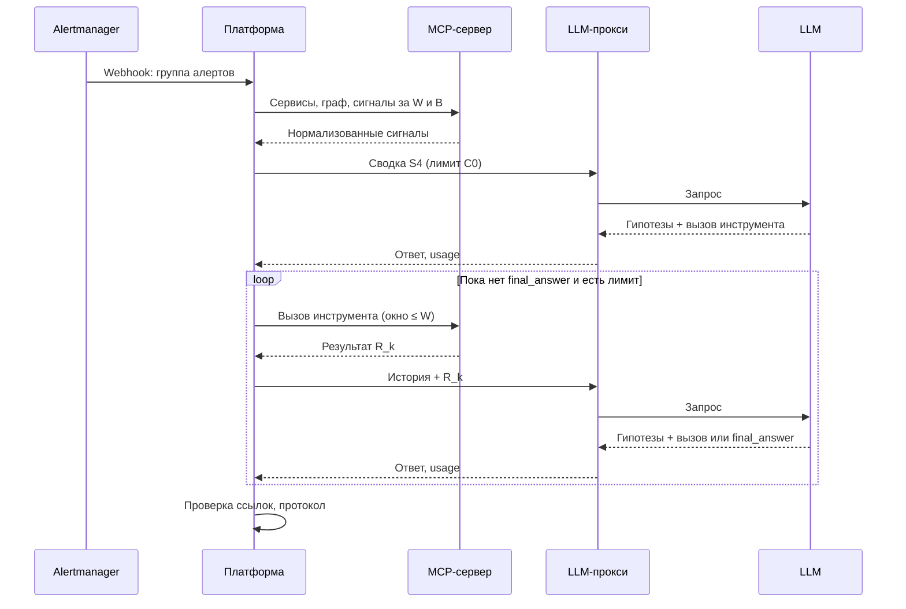

# 4.4. Алгоритмы диагностики

Пункт задания 4.4: однократная и пошаговая диагностика, гипотезы и рекомендации, лимиты, порядок взаимодействия.

Статус: черновик спринта 1 (16.11.2026). Обозначения — из [4.2-formalization.md](4.2-formalization.md).

## Стратегии

Лесенка: каждая ступень добавляет одну вещь.

| | Стратегия | Что делает | Запросы к LLM |
|---|---|---|---|
| S1 | Только правила | Рейтинг подозреваемых без LLM. Топ-3 = ответ. Причину и рекомендации не даёт | 0 |
| S2 | Наивная однократная | Алерт + последние N строк логов + сырые метрики, обрезка по лимиту | 1 |
| S3 | Однократная без графа | Сигналы + упаковка. Подозреваемые — по странности | 1 |
| S4 | Однократная с графом | S3 + «самый глубокий странный» по графу. **Главный вклад** | 1 |
| S5 | Пошаговая (наш агент) | Старт со сводки S4, дальше сама копает | ≤ $N_{max}$ |
| S6 | HolmesGPT | Внешний агент, с чистого листа | ≤ `--max-steps` |

```
S1 правила → S2 +LLM в лоб → S3 +фильтрация → S4 +граф → S5 +шаги      (S6 — ориентир)
```

## Общее начало всех стратегий

1. Принять инцидент $I$, зафиксировать $W$, $B$.
2. Сделать снимок конфигурации запуска.
3. Собрать данные за $W \cup B$ через провайдеры (MCP).
4. Нормализовать, отфильтровать → сигналы $\varepsilon$ (кроме S2 и S6).

## 1. Отбор подозреваемых (S1, S3, S4)

Странность сервиса: $a(v) = \max \text{score}$ его сигналов.

**С графом (S4, S1):**
1. $V_A$ — сервисы из алертов.
2. Кандидаты: от $V_A$ вниз по рёбрам (кого вызывают) до глубины $d_{down}$ = 3, вверх на $d_{up}$ = 1.
3. Оценка «самый глубокий странный»:

$$\text{rank}(v) = a(v) \cdot \Big(1 - \gamma \cdot \max_{u \in \text{out}(v)} a(u)\Big) + \delta \cdot k8s(v)$$

- странный сервис, у которого вызываемые в порядке, — выше;
- $k8s(v) = 1$, если в $W$ есть деплой или OOMKilled;
- $\gamma$, $\delta$ — настройки.
4. Топ-$K$ ($K$ = 5) подозреваемых.

**Без графа (S3):** кандидаты = $V_A$ ∪ сервисы с сигналом выше порога. Сортировка по $a(v)$. Топ-$K$.

Пример: frontend → checkout → payment. Ошибки у всех трёх. У payment вызываемые в порядке → payment первый.

S1 на этом заканчивается: топ-3 = три гипотезы, без причины и рекомендаций.

## 2. Упаковка в лимит (S3, S4)

Задача о рюкзаке. Сигнал $i$: вес $w_i$ (токены), польза $p_i$ (score). Лимит на сигналы $C' = C_{max} - C_{fixed}$.

$$\max \sum_i p_i x_i \quad \text{при} \quad \sum_i w_i x_i \le C', \quad x_i \in \lbrace 0, 1 \rbrace$$

Жадное приближение:
1. Обязательная часть $C_{fixed}$: инструкция, формат ответа, алерты, подозреваемые и связи между ними.
2. Каждому подозреваемому — его лучший сигнал.
3. Остальные — по убыванию $p_i / w_i$. Не влез — пробуем следующий.
4. Сгруппировать по сервисам.

Почему $p_i / w_i$: лог 0.9 на 800 токенов проигрывает трём метрикам 0.8 по 50 токенов.

## 3. Запрос и ответ LLM (S2–S5)

- Ответ — JSON по схеме $H$ (structured output). Сломан — запуск неудачный, без повтора.
- Сигналы подписаны номерами: `[S7] payment: доля ошибок 0.1% → 34%`. В доказательствах — номера.
- Температура минимальная, одинаковая для всех. Если провайдер не даёт менять — пишем это.
- Шаблон запроса — в конфиге, с версией. Один шаблон для S2–S4 и финального шага S5.
- В запросе нет описания внесённой поломки.

## 4. Проверка ссылок (S2–S6)

| Уровень | Проверка | Как |
|---|---|---|
| 1 | Ссылка существует: `S7` / `R3` был в запросе или протоколе | Авто |
| 2 | Ссылка по теме: сигнал или запрос про названный сервис или его рёбра | Авто |
| 3 | Данные подтверждают вывод | Инженер |

- Гипотезы не выкидываем и не переставляем. Только помечаем.
- В интерфейсе номер кликабельный → исходная запись по $\rho$.

## 5. Пошаговая стратегия (S5)

### Инструменты (через MCP)

| Инструмент | Что делает |
|---|---|
| `query_metrics(PromQL)` | Любой запрос к Prometheus |
| `query_logs(LogQL)` | Любой запрос к Loki |
| `query_traces(TraceQL)` | Любой запрос к Tempo |
| `k8s_get(...)` | Чтение объектов и событий K8s |
| `get_neighbors(s)` | Соседи по графу, статистика рёбер $B$ ↔ $W$ |
| `get_signals(s)` | Готовые сигналы сервиса |
| `final_answer(H)` | Завершить расследование |

Минимум правил:
- только чтение;
- время запроса не позже конца $W$ — подставляет платформа;
- огромный результат обрезается с пометкой «уточни запрос».

Каждый вызов получает номер `R1, R2, …`, результат — в протокол.

### Состояние

$$\sigma_k = (H_k, \text{calls}_{1..k}, \text{spent}_k)$$

- $H_k$ — текущие гипотезы после шага $k$;
- $\text{calls}$ — вызовы и результаты;
- $\text{spent}_k$ — потрачено времени, запросов, токенов.

### Цикл

1. Старт: упакованный контекст S4 на малый лимит $C_0$ (например, 8k).
2. На каждом шаге модель отвечает: гипотезы $H_k$ (формат как финальный), что проверит и зачем, вызов инструмента.
3. Платформа выполняет вызов, добавляет результат, обновляет $\text{spent}$.
4. Проверка остановки. Нет — шаг $k+1$.

### Остановка (что раньше)

1. Модель вызвала `final_answer`.
2. Лимит: следующий шаг не влезает → запрос «дай финальный ответ» из запаса.
3. Топчется: $K_{stall}$ = 3 шага подряд главная гипотеза та же и нет новых доказательств → финальный ответ.

Причина остановки пишется в протокол.

### Гипотезы и рекомендации

- Гипотезы на каждом шаге → протокол читается как рассуждение дежурного; кривая «качество по шагам».
- Рекомендации — в финальном ответе, к каждой гипотезе: тип «проверить» | «исправить», действие, ссылки.

## 6. HolmesGPT (S6)

- Запуск на том же инциденте и окне.
- Лимит — только `--max-steps` (например, 5 / 10 / 20). На последнем шаге HolmesGPT убирает инструменты — модель обязана дать итог.
- Токены и время — через общий LLM-прокси.
- Ответ приводим к формату $H$ для оценки [способ — решить при интеграции, спринт 2].

## Схема: однократная с графом (S4)



## Схема: пошаговая (S5)



## Последовательность (S5)


