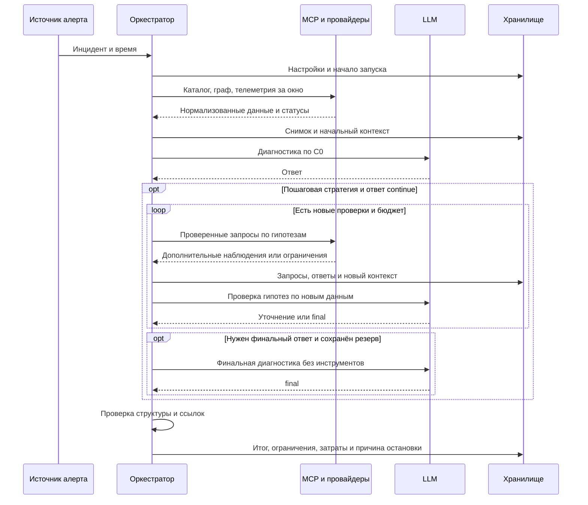
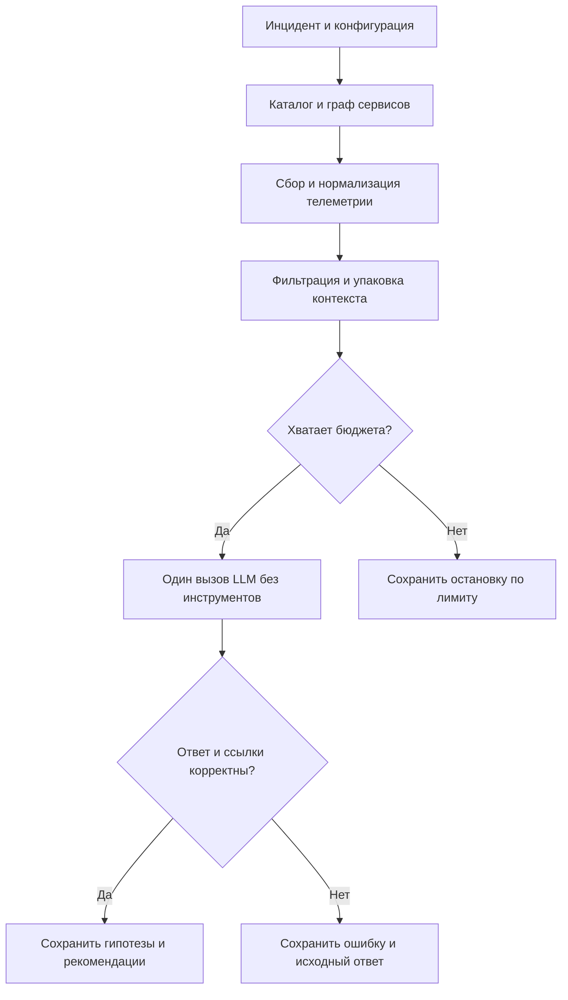
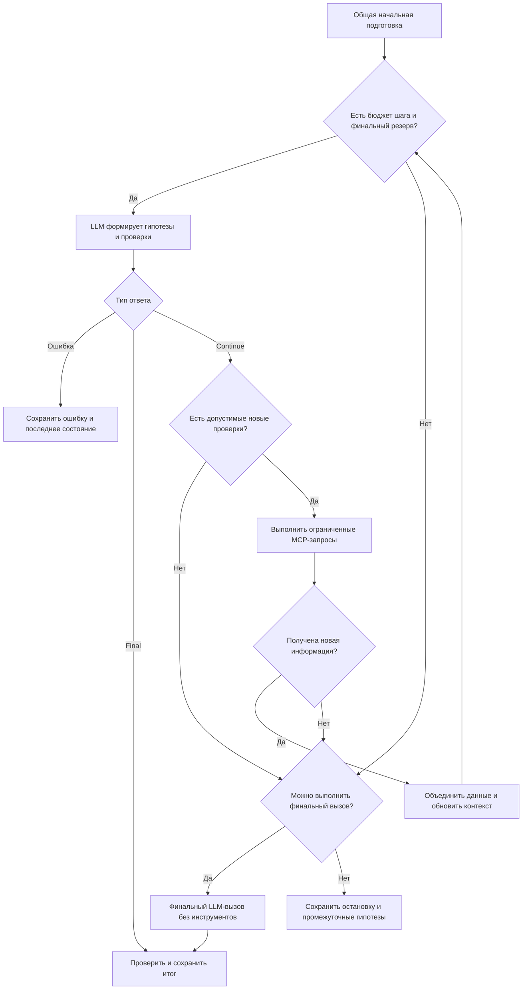

# Алгоритмы однократной и пошаговой диагностики

Версия 0.1 от 15.11.2026. Пункт 4.4, рабочая версия. Используются [модели и ограничения пункта 4.2](problem-formalization.md). Реализация и измерения запланированы на следующие спринты.

## Общий контракт

Вход: инцидент `I`, разрешённая область сервисов, конфигурация источников и модели, временные окна, правила отбора, бюджеты. Выход: ранжированные гипотезы и рекомендации, ограничения данных, причина остановки, протокол запросов и точные контексты всех LLM-вызовов.

Роли компонентов:

| Компонент | Ответственность |
| --- | --- |
| Оркестратор приложения | Создать запуск, управлять состоянием и бюджетами, вызвать LLM и MCP, проверить ответ, сохранить протокол |
| MCP-сервер и провайдеры | Получить данные из Prometheus, Loki, Tempo, Kubernetes; ограничить ответы; нормализовать; сообщить полноту и ошибки |
| Формирователь контекста | Детерминированно отфильтровать, агрегировать и упаковать наблюдения со ссылками |
| LLM | Предложить гипотезы, объяснить данные, сформировать рекомендации и для пошаговой стратегии план дополнительной проверки |
| Хранилище | Сохранить инцидент, снимки, настройки, обращения, ответы, затраты, итог и оценку инженера |

Статусы: `completed`, `insufficient_data`, `budget_exhausted`, `failed`, `invalid_output`. При исчерпании бюджета сохраняются промежуточные гипотезы с явной отметкой, что финального ответа нет. Отдельно хранится причина остановки: итог, отсутствие новых данных, лимит времени/запросов/токенов, ошибка модели или формата.

## Общая начальная подготовка

1. Проверить вход, создать `run_id`, сохранить версии конфигурации и момент начала; установить deadline.
2. Определить `W` и `W_base`. Получить через провайдеры каталог сервисов и ограниченную топологию для разрешённого namespace и периода. Зафиксировать неразрешённые метки и недоступные источники.
3. Построить `S0` из сервиса алерта и соседей радиуса `r`. При недостатке топологии применить явно заданный fallback из формализации.
4. По общей политике запросить метрики `S0` за `W` и `W_base`, логи за `W`, ошибки и медленные трассы за `W`. Независимые запросы допустимо выполнять параллельно в пределах общего бюджета. Каждый запрос имеет timeout и предел размера ответа.
5. Нормализовать результаты, построить локальный граф, удалить повторы, сформировать признаки отклонений. Для отсутствующих данных сохранить статус; не подставлять нули вместо ошибок получения.
6. Сформировать `C0` по общим правилам квот и приоритетов, сохранить manifest. Передать одинаковый начальный набор наблюдений обеим стратегиям. Инструкции различаются разрешением на дополнительные проверки.

Эталон, название и способ внесения сбоя недоступны через алерт, инструменты и контекст. Состояние тестового feature flag, раскрывающее неисправность, также исключается.

## Однократная диагностика

Приложение один раз передаёт LLM контекст `C0`, инструкцию и схему ответа. Модель возвращает ранжированные гипотезы, наблюдения за и против, недостающие данные и рекомендации. Если причина не определена, допустим `insufficient_data` с пустым списком.

Дополнительные данные модель запросить не может: инструменты этому вызову недоступны. Нужную проверку она может рекомендовать инженеру.

```text
OneShot(I, config):
    run = StartRun(I, config)
    C0 = PrepareInitialContext(I, config, run.budget)
    if no budget for one bounded LLM call:
        return Save(run, budget_exhausted, stop_reason)
    prompt = BuildDiagnosticPrompt(C0, final_schema)
    raw = CallLLMOnce(prompt, output_limit, remaining_deadline)
    if transport/model error:
        return Save(run, failed, raw_error)
    result = ParseAndValidate(raw, allowed_evidence=C0.evidence_ids)
    if invalid structure or unknown/out-of-context evidence IDs:
        return Save(run, invalid_output, raw, validation_errors)
    return Save(run, result.status, result, prompt, usage)
```

Автоматические повторы и исправления через LLM выключены. Ручной повтор создаёт новый запуск. Если попытка дошла до модели, вызов ровно один; при исчерпании бюджета на сборе их ноль. Сырые ответы и ошибки сохраняются.

Алгоритм завершается проверенным ответом либо сохранённой причиной, по которой получить его не удалось. Дополнительного LLM-анализа нет.

## Пошаговая диагностика

Состояние шага `k`: `X_k = (E_k, G_k, H_k, executed_queries, budget_remaining)`. `E_k` содержит все наблюдения, текущий контекст только выбранную часть. Гипотеза имеет устойчивый ID и статус `candidate`, `supported`, `contradicted` или `unresolved`. Статус отражает интерпретацию данных, не доказанную причинность.

Первый вызов получает `C0`. Каждый ответ имеет один из двух типов:

- `continue`: текущие гипотезы и не более заданного числа проверок с ID гипотезы, вопросом, именем инструмента, структурированными параметрами и ожидаемым различающим наблюдением;
- `final`: итоговая диагностика в общей схеме результата.

Задержку downstream-сервиса проверяют трассами с длительностями spans и ошибками за выбранное окно. Модель указывает, какое наблюдение поддержит или ослабит гипотезу. Совпадения времени недостаточно.

### Выбор и выполнение проверок

Оркестратор проверяет инструмент, параметры, сервисы, окно, размер ответа и бюджет. Первая версия использует `get_metrics`, `get_logs`, `get_traces`, `get_service_catalog`, `get_dependencies`. Провайдеры строят PromQL/LogQL по разрешённым шаблонам, ограничивая запросы и облегчая воспроизведение.

Проверки исполняются в порядке модели, затем по стабильному ID. За шаг допускается не более `M` проверок в пределах бюджета. Переход к соседу требует ребра графа или явной связи в телеметрии. Произвольное расширение на весь кластер запрещено.

Ключ проверки: `(tool, source, services, window, filters, aggregation)`. Для идентичного запроса используется сохранённый ответ. Изменённое окно или фильтр считаются новым запросом. Неверные параметры не исполняются; причина отклонения передаётся модели при следующем доступном вызове.

Ответы нормализуются и добавляются в `E_k` по устойчивым ID. Порядок контекста: инцидент и ограничения, гипотезы, новые проверки, наблюдения за и против, нужный граф. Отдельная LLM историю не суммирует. Модель получает список исключённых старых данных; пересказ не заменяет исходные наблюдения.

Финальные ссылки допускаются только на наблюдения текущего контекста. При упаковке оркестратор возвращает важные данные прошлых шагов. Одного ID из исключённой истории недостаточно.

### Условия остановки

1. Модель вернула корректный `final`, включая допустимый отказ от диагноза.
2. Исчерпан лимит шагов, запросов, токенов или времени.
3. В ответе нет допустимых новых проверок либо выполненные проверки не дали ни новых наблюдений, ни изменений статусов доступности. Информация о пустом или недоступном источнике сама является новым результатом при первом получении.
4. Ошибка LLM или неверная структура ответа не позволяют продолжить.

После остановки по пунктам 2–3 выполняется резервный финальный вызов без инструментов, если остались время и токены. Модель получает ограничения и возвращает диагноз или `insufficient_data`. Резерв нельзя тратить на новые проверки. При истёкшем deadline сохраняется последнее корректное состояние с `budget_exhausted`, без нового вызова.

Исследовательских вызовов не больше `min(K_max, L_max - 1)`. Любой может вернуть `final`, тогда резервный вызов не нужен. Резерв включает один вызов, входные токены, ограниченный выход и время `T_final`; размеры определяются пилотом.

```text
Stepwise(I, config):
    run = StartRun(I, config)
    state = Init(PrepareInitialContext(I, config, run.budget))
    stop_reason = null
    for k in 1 .. min(K_max, L_max - 1):
        if cannot afford exploration while preserving final reserve:
            stop_reason = budget_limit; break
        Ck = PackContext(state, exploration_budget)
        answer = CallAndValidateLLM(Ck, continue_or_final_schema)
        if call/validation failed: return SaveFailureWithLastState(run, state)
        state.hypotheses = answer.hypotheses
        if answer.type == final: return SaveFinal(run, answer)
        plans = ValidateAndDeduplicate(answer.checks, state)
        if plans is empty: stop_reason = no_new_checks; break
        delta = ExecuteBoundedChecks(plans, preserve_final_reserve=true)
        if delta has no new observations or source statuses:
            stop_reason = no_new_data; break
        state = Merge(state, delta)
    if stop_reason is null: stop_reason = step_limit
    if can afford reserved final call:
        Cf = PackContext(state, final_budget, stop_reason)
        return SaveValidatedFinalOrFailure(CallFinalOnly(Cf), state)
    return Save(run, budget_exhausted, state, stop_reason)
```

Гипотезы обновляются при следующем LLM-вызове после получения данных. Формальный признак и заявленный confidence не подтверждают диагноз и не определяют остановку.

## Формат ответа и проверка

Пример структуры, а не результат эксперимента:

```json
{
  "type": "final",
  "status": "insufficient_data",
  "hypotheses": [
    {
      "id": "h1",
      "rank": 1,
      "service": "demo/shop/service-b",
      "cause": "Предполагаемая задержка обработки обращений к зависимости",
      "supports": [{"evidence_id": "span-001", "reason": "Основная задержка запроса приходится на этот span"}],
      "contradicts": [],
      "missing": ["Нет метрик ресурса зависимости для различения причин задержки"],
      "recommendations": [{"type": "verify", "action": "Проверить длительности и ошибки зависимости за окно инцидента", "expected": "Установить, локальна ли задержка для зависимости"}]
    }
  ],
  "limitations": ["Источник метрик недоступен"]
}
```

Схема запрещает дубли ID и рангов, неизвестные service_key без отметки неопределённости, несуществующие ссылки и пропуски обязательных полей. Логи считаются данными, не инструкциями. Проверка ссылок устанавливает происхождение наблюдений; интерпретация оценивается отдельно.

## Порядок взаимодействия



## Схемы алгоритмов

Однократная стратегия:



Пошаговая стратегия:



## Проверка полноты формализации

- Для обеих стратегий определены вход, выход, общая подготовка, взаимодействие компонентов и ошибки.
- Для однократной стратегии определены источники, нормализация, отбор, упаковка и один LLM-вызов.
- Для пошаговой стратегии определены состояние, формирование гипотез, выбор проверки, получение данных, обновление контекста и остановка.
- Граф используется при начальном отборе сервисов и при расширении пошагового расследования.
- Рекомендации связаны с гипотезами и разделены на проверку и устранение; их полезность измеряется по [методике](../evaluation/methodology.md).
- Числовые лимиты, квоты и наборы метрик предстоит уточнить на пилоте и зафиксировать до итогового эксперимента.
