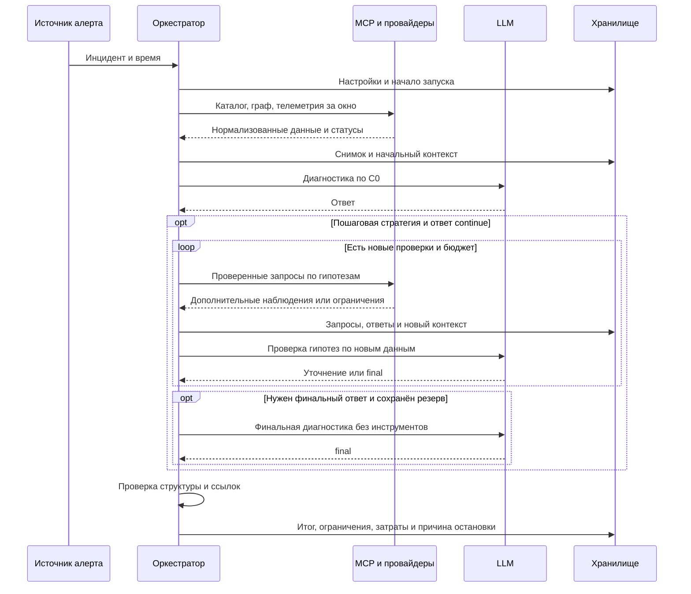
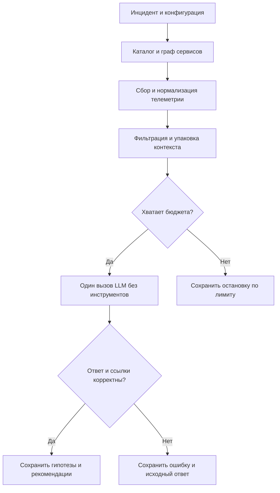
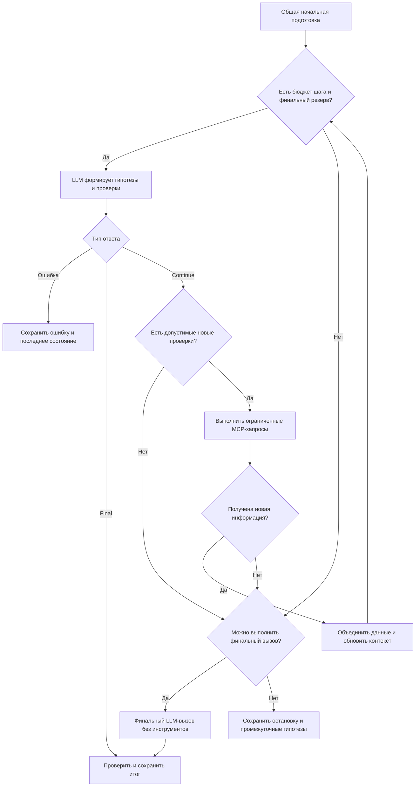

# Алгоритмы однократной и пошаговой диагностики

Версия 0.1 от 15.11.2026. Результат формализации по пункту 4.4 задания для обсуждения. Используются [модели и ограничения пункта 4.2](problem-formalization.md). Реализация и измерения относятся к следующим спринтам.

## Общий контракт

Вход: инцидент `I`, разрешённая область сервисов, конфигурация источников и модели, временные окна, правила отбора, бюджеты. Выход: ранжированные гипотезы и рекомендации, ограничения данных, причина остановки, протокол запросов и точные контексты всех LLM-вызовов.

Роли компонентов:

| Компонент | Ответственность |
| --- | --- |
| Оркестратор приложения | Создать запуск, управлять состоянием и бюджетами, вызвать LLM и MCP, проверить ответ, сохранить протокол |
| MCP-сервер и провайдеры | Получить данные из Prometheus, Loki, Tempo, Kubernetes; ограничить ответы; нормализовать; сообщить полноту и ошибки |
| Формирователь контекста | Детерминированно отфильтровать, агрегировать и упаковать наблюдения со ссылками |
| LLM | Предложить гипотезы, объяснить данные, сформировать рекомендации и для пошаговой стратегии план дополнительной проверки |
| Хранилище | Сохранить инцидент, снимки, настройки, обращения, ответы, затраты, итог и оценку инженера |

Статусы запуска: `completed`, `insufficient_data`, `budget_exhausted`, `failed`, `invalid_output`. Полезные промежуточные гипотезы могут сохраняться при исчерпании бюджета, но не считаются полноценным финальным ответом. Причина остановки хранится отдельно: финальный ответ, отсутствие новых данных, лимит времени, лимит запросов, лимит токенов, ошибка модели или неверный формат.

## Общая начальная подготовка

1. Проверить вход, создать `run_id`, сохранить версии конфигурации и момент начала; установить deadline.
2. Определить `W` и `W_base`. Получить через провайдеры каталог сервисов и ограниченную топологию для разрешённого namespace и периода. Зафиксировать неразрешённые метки и недоступные источники.
3. Построить `S0` из сервиса алерта и соседей радиуса `r`. При недостатке топологии применить явно заданный fallback из формализации.
4. По общей политике запросить метрики `S0` за `W` и `W_base`, логи за `W`, ошибки и медленные трассы за `W`. Независимые запросы допустимо выполнять параллельно в пределах общего бюджета. Каждый запрос имеет timeout и предел размера ответа.
5. Нормализовать результаты, построить локальный граф, удалить повторы, сформировать признаки отклонений. Для отсутствующих данных сохранить статус; не подставлять нули вместо ошибок получения.
6. Сформировать `C0` по общим правилам квот и приоритетов, сохранить manifest. Передать одинаковый начальный набор наблюдений обеим стратегиям. Инструкции различаются разрешением на дополнительные проверки.

Для предотвращения утечки методика создания сбоя, его название и эталонный диагноз не попадают в алерт, инструменты и контекст. Если тестовый feature flag явно называет неисправность, административные сведения о его состоянии исключаются из доступа модели.

## Однократная диагностика

После начальной подготовки приложение один раз передаёт модели `C0`, инструкцию диагностики и схему ответа. Модель должна вернуть ранжированный список гипотез, наблюдения в поддержку и против них, недостающие сведения и рекомендации. При невозможности определить причину допустим ответ `insufficient_data` с пустым списком.

Запрос дополнительных данных моделью не исполняется. Такой запрос может быть представлен только как рекомендация инженеру. Инструменты не включаются в список доступных LLM-инструментов этого вызова.

```text
OneShot(I, config):
    run = StartRun(I, config)
    C0 = PrepareInitialContext(I, config, run.budget)
    if no budget for one bounded LLM call:
        return Save(run, budget_exhausted, stop_reason)
    prompt = BuildDiagnosticPrompt(C0, final_schema)
    raw = CallLLMOnce(prompt, output_limit, remaining_deadline)
    if transport/model error:
        return Save(run, failed, raw_error)
    result = ParseAndValidate(raw, allowed_evidence=C0.evidence_ids)
    if invalid structure or unknown/out-of-context evidence IDs:
        return Save(run, invalid_output, raw, validation_errors)
    return Save(run, result.status, result, prompt, usage)
```

Автоматическое исправление ответа ещё одним LLM-запросом и автоматические LLM-повторы выключены. Повтор инженером создаёт новый запуск. Ровно один вызов относится к попытке, дошедшей до модели; при исчерпании бюджета на сбор данных вызовов может быть ноль. Сырые ответы и ошибки не теряются.

Критерий завершения: один ответ получен и проверен либо зафиксирована невозможность его получить. Результат не улучшается дополнительным скрытым анализом моделью.

## Пошаговая диагностика

Состояние на шаге `k`: `X_k = (E_k, G_k, H_k, executed_queries, budget_remaining)`. `E_k` хранит все полученные наблюдения, а текущий контекст может включать только их часть. У каждой гипотезы есть устойчивый ID и состояние `candidate`, `supported`, `contradicted`, `unresolved`. Состояния отражают интерпретацию наблюдений, а не доказанную причинность.

Первый вызов получает `C0`. Каждый ответ имеет один из двух типов:

- `continue`: текущие гипотезы и не более заданного числа проверок с ID гипотезы, вопросом, именем инструмента, структурированными параметрами и ожидаемым различающим наблюдением;
- `final`: итоговая диагностика в общей схеме результата.

Например, гипотезу о задержке downstream-сервиса проверяет запрос трасс с длительностями его spans и ошибок за конкретное окно. Само совпадение времени не подтверждает механизм сбоя. Модель должна обозначить, какое наблюдение поддержит или ослабит гипотезу.

### Выбор и выполнение проверок

Оркестратор проверяет имя инструмента, схему параметров, разрешённые сервисы, окно, размер ответа и оставшийся бюджет. Для первой версии используются типизированные инструменты `get_metrics`, `get_logs`, `get_traces`, `get_service_catalog`, `get_dependencies`. Конкретные PromQL/LogQL-запросы строятся провайдерами по разрешённым шаблонам, что ограничивает область запросов и облегчает воспроизведение.

Приоритет проверок задаётся порядком модели, затем стабильным ID. За один шаг исполняется не более `M` разрешённых проверок, пока хватает бюджета. Переход к соседнему сервису разрешается по наблюдаемому ребру графа или явно указанной связи в телеметрии. Произвольное расширение на весь кластер не допускается.

Проверка уникальна по ключу `(tool, source, services, window, filters, aggregation)`. Уже выполненный идентичный запрос не повторяется; используется сохранённый результат. Новое окно или фильтр являются новым запросом и учитываются в затратах. Запросы с неверными параметрами не исполняются, а причина отклонения возвращается модели при следующем доступном вызове.

Новые ответы нормализуются и объединяются с `E_k` по устойчивым ID. Приоритет следующего контекста: условия инцидента и ограничения, текущие гипотезы, новые результаты проверок, наблюдения в поддержку и против гипотез, релевантная часть графа. История не суммируется отдельной моделью. Если данные прежнего шага исключены из текущего контекста, модель получает список исключений; фактические утверждения из истории не подменяют исходные наблюдения.

Ссылки финального ответа должны указывать на наблюдения, присутствующие в его текущем контексте. Оркестратор заранее возвращает важные ранее использованные наблюдения при упаковке. Это позволяет проверить финальный вывод и не считать ID из забытой истории достаточным обоснованием.

### Условия остановки

1. Модель вернула корректный `final`, включая допустимый отказ от диагноза.
2. Исчерпан лимит шагов, запросов, токенов или времени.
3. В ответе нет допустимых новых проверок либо выполненные проверки не дали ни новых наблюдений, ни изменений статусов доступности. Информация о пустом или недоступном источнике сама является новым результатом при первом получении.
4. Ошибка LLM или неверная структура ответа не позволяют продолжить.

После пунктов 2–3 оркестратор выполняет зарезервированный финальный вызов без инструментов, если для него остаются время и токены. Модель получает ограничения и должна выдать лучшую доступную диагностику или `insufficient_data`. Нельзя начинать дополнительную проверку за счёт резерва финального ответа. Если deadline уже истёк, сохраняется последний корректный промежуточный результат со статусом `budget_exhausted`, без нового обращения к модели.

Число исследовательских вызовов не превышает `min(K_max, L_max - 1)`. Каждый из них может сразу вернуть `final`; в этом случае резервный вызов не нужен. Резерв состоит из одного вызова, токенов его входа и ограниченного выхода, а также настроенного времени `T_final`; его размер определяется пилотом.

```text
Stepwise(I, config):
    run = StartRun(I, config)
    state = Init(PrepareInitialContext(I, config, run.budget))
    stop_reason = null
    for k in 1 .. min(K_max, L_max - 1):
        if cannot afford exploration while preserving final reserve:
            stop_reason = budget_limit; break
        Ck = PackContext(state, exploration_budget)
        answer = CallAndValidateLLM(Ck, continue_or_final_schema)
        if call/validation failed: return SaveFailureWithLastState(run, state)
        state.hypotheses = answer.hypotheses
        if answer.type == final: return SaveFinal(run, answer)
        plans = ValidateAndDeduplicate(answer.checks, state)
        if plans is empty: stop_reason = no_new_checks; break
        delta = ExecuteBoundedChecks(plans, preserve_final_reserve=true)
        if delta has no new observations or source statuses:
            stop_reason = no_new_data; break
        state = Merge(state, delta)
    if stop_reason is null: stop_reason = step_limit
    if can afford reserved final call:
        Cf = PackContext(state, final_budget, stop_reason)
        return SaveValidatedFinalOrFailure(CallFinalOnly(Cf), state)
    return Save(run, budget_exhausted, state, stop_reason)
```

Обновление гипотез происходит при следующем LLM-вызове после получения результатов. Оркестратор не подтверждает диагноз по одному формальному признаку и не использует заявленный моделью confidence как основание остановки.

## Формат ответа и проверка

Пример структуры, а не результат эксперимента:

```json
{
  "type": "final",
  "status": "insufficient_data",
  "hypotheses": [
    {
      "id": "h1",
      "rank": 1,
      "service": "demo/shop/service-b",
      "cause": "Предполагаемая задержка обработки обращений к зависимости",
      "supports": [{"evidence_id": "span-001", "reason": "Основная задержка запроса приходится на этот span"}],
      "contradicts": [],
      "missing": ["Нет метрик ресурса зависимости для различения причин задержки"],
      "recommendations": [{"type": "verify", "action": "Проверить длительности и ошибки зависимости за окно инцидента", "expected": "Установить, локальна ли задержка для зависимости"}]
    }
  ],
  "limitations": ["Источник метрик недоступен"]
}
```

Итоговая схема должна запрещать дубли ID и рангов, неизвестные service_key без явного признака неопределённости, несуществующие ссылки и отсутствие обязательных полей. Текст логов рассматривается как данные, а не как инструкция. Проверка ссылок подтверждает происхождение наблюдений; правильность интерпретации оценивается отдельно.

## Порядок взаимодействия



## Схемы алгоритмов

Однократная стратегия:



Пошаговая стратегия:



## Проверка полноты формализации

- Для обеих стратегий определены вход, выход, общая подготовка, взаимодействие компонентов и ошибки.
- Для однократной стратегии определены источники, нормализация, отбор, упаковка и один LLM-вызов.
- Для пошаговой стратегии определены состояние, формирование гипотез, выбор проверки, получение данных, обновление контекста и остановка.
- Граф используется при начальном отборе сервисов и при расширении пошагового расследования.
- Рекомендации связаны с гипотезами и разделены на проверку и устранение; их полезность измеряется по [методике](../evaluation/methodology.md).
- Числовые лимиты, квоты и наборы метрик предстоит уточнить на пилоте и зафиксировать до итогового эксперимента.
