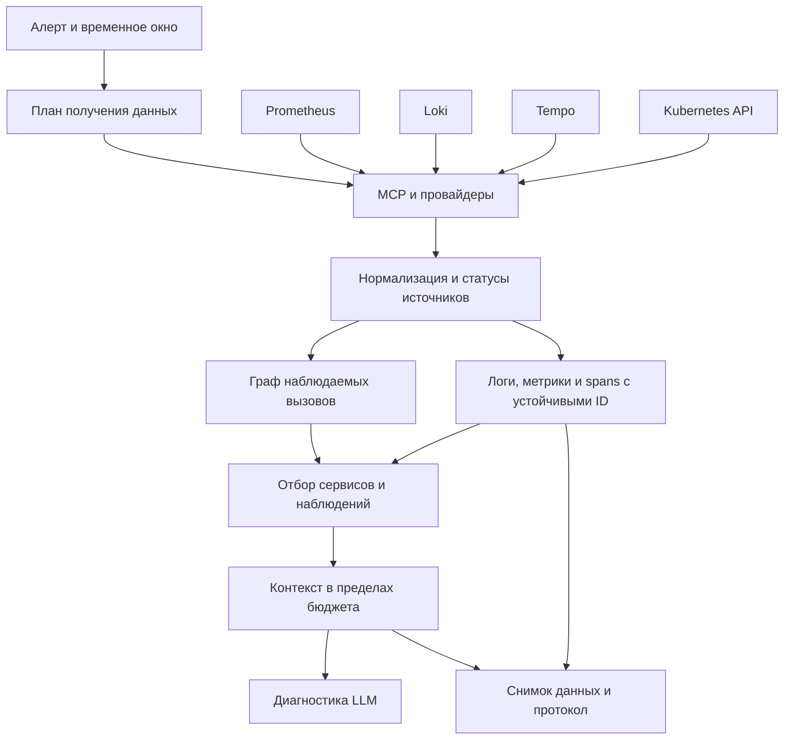

# Формализация задачи диагностики инцидента

Версия 0.1 от 15.11.2026. Рабочее решение по пункту 4.2 задания, подготовленное к обсуждению с руководителем. Алгоритмы определены в [отдельном документе](diagnostic-algorithms.md), критерии и эксперимент в [методике оценки](../evaluation/methodology.md).

## Задача и границы

Система получает уведомление об инциденте, собирает доступную телеметрию и сведения о связях сервисов, формирует ранжированные гипотезы о проблемном сервисе и причине, предлагает действия для проверки или устранения. Каждая гипотеза ссылается на использованные наблюдения. Действия по устранению выполняет инженер.

Для первой версии рассматривается один инициирующий сбой в микросервисном приложении Kubernetes. Распространение его симптомов на несколько сервисов допускается. Одновременные независимые причины относятся к дальнейшему развитию. Доступные источники могут быть неполными или временно недоступными.

Инцидент задаётся кортежем `I = (id, t_alert, t_received, labels, description, S_alert)`. Здесь `t_alert` обозначает время срабатывания, `t_received` время получения, а `S_alert` множество сервисов, сопоставленных с метками уведомления. Неопределённый сервис представляется явно, а не заменяется предположением модели.

Временное окно диагностики `W = [t_alert - Δ_before, t_alert + Δ_after]`. Для исторического эксперимента окно целиком зафиксировано. Для работы онлайн правая граница ограничена временем начала расследования; система не ожидает будущие данные без отдельного режима. Период сравнения с нормой `W_base` заканчивается до предполагаемого начала сбоя и хранится отдельно.

Искомый результат `R = (status, H, limitations, stop_reason)`, где `H = [h1, …, hk]` упорядочен по предпочтению модели; пустой список допустим. Для сценария известны эталонные сервис и механизм сбоя, но они доступны только процедуре оценки.

## Модели данных

Все нормализованные объекты имеют `evidence_id`, `source_id`, `source_record_id` при наличии, временные поля, `service_key` при возможности сопоставления, `raw_ref` и сведения о преобразовании. `evidence_id` устойчив в пределах снимка и не меняется при перестановке записей. Для вычисленного агрегата сохраняются запрос, границы окна, функция агрегации и ссылки на исходный набор. Ссылка на исходник может вести в сохранённый снимок; наличие URL внешнего интерфейса необязательно.

| Объект | Содержательные поля |
| --- | --- |
| Лог | timestamp, severity, message, attributes, trace_id, span_id, request_id |
| Метрика | имя, единица, labels, тип, временной ряд или агрегат, шаг и границы интервалов |
| Span | trace_id, span_id, parent_span_id, начало, длительность, статус, ресурс и атрибуты |
| Сервис | cluster, namespace, service, известные workload/pod и период действия соответствия |
| Связь | caller, callee, период наблюдения, число вызовов, ошибки, длительности, ссылки на трассы |
| Результат запроса | source_id, параметры, время выполнения, status, полнота, данные, ограничения |

Статусы запроса: `ok`, `empty`, `partial`, `unavailable`, `timeout`, `invalid_query`, `not_captured`. `empty` означает успешный запрос без записей, а `not_captured` отсутствие нужного покрытия в сохранённом наборе. Недоступность источника не означает нормальную работу сервиса.

Идентификатор сервиса: `service_key = (cluster, namespace, service)`. Сопоставления `service.name`, меток Prometheus, Kubernetes Service/workload/pod задаются конфигурацией и обнаружением ресурсов с учётом времени. Несопоставленные записи остаются с `service_key = null` и исходными метками. Не объединять одинаковые имена из разных namespace или кластеров.

## Нормализация и происхождение

1. Время приводится к UTC с сохранением исходного значения и точности. Известное смещение часов учитывается явно; точного совпадения timestamps для связи событий не требуется.
2. Единицы метрик приводятся к принятой единице конкретной метрики. Counter анализируется через прирост или rate с учётом сброса, gauge через значение и распределение. Несопоставимые единицы и разные наборы labels не смешиваются.
3. Уровни логирования сопоставляются общей шкале. Сообщение и исходные атрибуты сохраняются; неизвестная severity остаётся неизвестной.
4. Связь событий по trace/span ID считается точной идентификационной связью. Совпадение сервиса и времени является временной корреляцией, а не доказанной причинной связью.
5. Повторы при пагинации удаляются по исходному ID или ключу источника и содержимого. Разные реальные одинаковые сообщения объединяются только в агрегат с количеством и диапазоном времени.
6. Усечённые, агрегированные и несопоставленные данные получают соответствующие признаки; исходные данные сохраняются вне контекста модели. Нормализация не дописывает отсутствующие наблюдения.

## Граф зависимостей

`G_W = (V, E_W)`, где вершины обозначают сервисы, а ориентированное ребро `u → v` означает наблюдавшийся вызов из `u` в `v`. Рёбра извлекаются из клиентских/серверных spans по parent-child связи и атрибутам удалённого сервиса с сохранением правила извлечения. Для внешней зависимости допустима отдельная вершина с признаком внешнего ресурса.

Атрибуты ребра включают период наблюдения и покрытие трассировок. Граф за `W_base` может дополнять граф за `W`, но происхождение рёбер различается. Отсутствие ребра при sampling или пропавшей трассировке не доказывает отсутствие вызовов. Kubernetes API даёт состав и соответствия ресурсов, но сам по себе не доказывает фактический вызов между сервисами.

`N_r(S)` обозначает сервисы на расстоянии не более `r` рёбер от `S` при обходе в обоих направлениях. Направление вызова сохраняется в контексте: upstream может показывать распространение симптома, downstream потенциальную зависимость с причиной сбоя. Обход ограничивается namespace, разрешённой областью и лимитом числа сервисов.

## Подготовка контекста

Получение данных выполняют провайдеры Prometheus, Loki, Tempo и Kubernetes через инструменты MCP. Приложение управляет последовательностью и лимитами, MCP-сервер выполняет проверенные запросы и нормализацию. Для однократной стратегии MCP вызывается приложением до обращения к LLM; модель не выбирает дополнительные инструменты.

Общая подготовка включает разрешение меток алерта, ограниченный запрос топологии, построение `S0 = S_alert ∪ N_r(S_alert)` и сбор телеметрии по этому набору. Если граф или сервис неизвестен, применяется заданный в конфигурации ограниченный набор сервисов; это отмечается как ограничение. Полный опрос кластера не используется как неявная замена.

Фильтрация сначала выполняется на стороне источников по времени, сервисам и разрешённым labels, затем локально: удаление повторов, агрегация, ранжирование и упаковка. Приоритет имеют сведения о сервисе алерта, ошибки и медленные spans, отклонения выбранных метрик от `W_base`, связанные логи. Для логов сохраняется ограниченное окружение ошибок; для трасс сохраняются связи, необходимые для понимания цепочки вызовов. Выбор только ошибок не должен удалять все наблюдения нормального поведения.

Правило упаковки детерминировано и версионируется: обязательные метаданные и ограничения, затем фиксированные квоты по типам телеметрии и сервисам, внутри квоты сортировка по приоритету, времени и ID. Неиспользованная квота перераспределяется в заданном порядке. Числа до и после фильтрации сохраняются. Частичная запись или агрегат не выдаются за полный исходник. В первой версии для подготовки контекста не используется дополнительная LLM.

Формальный вариант приоритета внутри квоты: лексикографически убывающий кортеж `(is_alert_service, is_abnormal, has_incident_trace_link, -graph_distance, timestamp)`, затем возрастающий `evidence_id` для разрешения равенства. `is_abnormal` задаётся типом: log имеет WARN/ERROR/FATAL, span имеет ошибку или длительность выше порога своей операции, метрика нарушает настроенный абсолютный порог либо порог отклонения от baseline. Неизвестное отклонение не приравнивается к норме и сохраняется отдельным признаком. Набор метрик, формула отклонения, пороги и квоты входят в конфигурацию, выбираются на пилоте и не меняются между итоговыми парными запусками. Если времени baseline недостаточно, вычисление отклонения пропускается с объяснением.

Упаковщик последовательно добавляет целые записи/агрегаты по этому порядку, пока соблюдены квоты и `C_max`; не помещающаяся запись пропускается с указанием причины. Для начального контекста квоты перераспределяются в порядке «метрики, трассы, логи», для пошагового контекста сначала выделяется квота новым результатам проверок. Если не помещаются обязательные метаданные и схема, вызов не выполняется. Таким образом выбор данных однозначен при фиксированной конфигурации, хотя её числовые параметры ещё подлежат пилотной настройке.

`C = (I, W, W_base, G_local, E_selected, source_statuses, selection_manifest, instructions)`. Manifest перечисляет переданные ID, преобразования, усечения и причины отбора. Модель получает только выбранные данные; исходный архив не считается частью её контекста.

## Гипотезы и рекомендации

Гипотеза `h = (id, rank, service, cause, supports, contradicts, missing, recommendations)`. `supports` и `contradicts` содержат ID наблюдений и объяснение связи с утверждением; `missing` указывает, чего не хватает для проверки. Рекомендация имеет тип `verify` или `remediate`, связана с гипотезой и содержит действие, ожидаемый результат проверки или предпосылку применения.

Ранжирование является выводом модели, а не измеренной вероятностью. Числовой confidence в первой версии не используется как достоверность и не определяет остановку. Система проверяет существование ссылок, принадлежность переданному контексту и структуру ответа. Содержательную поддержку и правильность причины оценивает инженер по методике.

## Ограничения затрат

Для запуска задаются: deadline `T_max`, максимум LLM-вызовов `L_max`, максимум запросов к данным `Q_max`, лимит шагов `K_max`, лимит контекста одного вызова `C_max`, совокупный токенный бюджет `B_total` и лимиты числа записей/байтов одного ответа источника. Каждый фактический запрос страницы и повтор учитывается в `Q_max`; каждый запрос к LLM, включая завершившийся ошибкой, в `L_max`. Время измеряется монотонными часами от начала получения данных до сохранения результата.

Перед LLM-вызовом проверяется `tokens(prompt) + reserved_output ≤ model_window` и доступность совокупного бюджета. Повторно переданная история повторно учитывается во входных токенах. Провайдерский usage хранится отдельно от предварительной оценки токенизатором; неизвестный usage при сетевой ошибке не записывается нулём.

Пример начальных параметров для пилота: `Δ_before = 10 мин`, `Δ_after = 0`, `W_base` за предшествующие 10 минут до окна, `r = 1`, `K_max = 4`, `L_max = 5` для пошаговой и `L_max = 1` для однократной. Для пошаговой под финальный ответ резервируется один из пяти вызовов. `C_max`, `B_total`, `Q_max` и `T_max` выбираются после технического пилота с учётом модели и стенда. Эти значения являются предложением, а не результатом измерений или согласованными требованиями.

## Схема подготовки данных

План получения включает ограниченный запрос каталога и топологии, затем телеметрию начального набора сервисов. Граф и отбор уточняются по полученным трассам. Схема показывает поток данных; порядок запросов определён в алгоритмах.

## Соответствие пункту 4.2

| Требование задания | Результат |
| --- | --- |
| Постановка задачи | Вход `I`, окно `W`, результат `R`, область применения |
| Модели телеметрии | Общие поля происхождения и отдельные модели логов, метрик, spans |
| Граф сервисов | `G_W`, направление рёбер, построение и ограничения покрытия |
| Нормализация | Время, сервисы, единицы, связи, повторы и неполнота |
| Критерии качества | [Методика с определениями и шкалами](../evaluation/methodology.md) |
| Вычислительные ограничения | Лимиты времени, вызовов, контекста и совокупных токенов |
