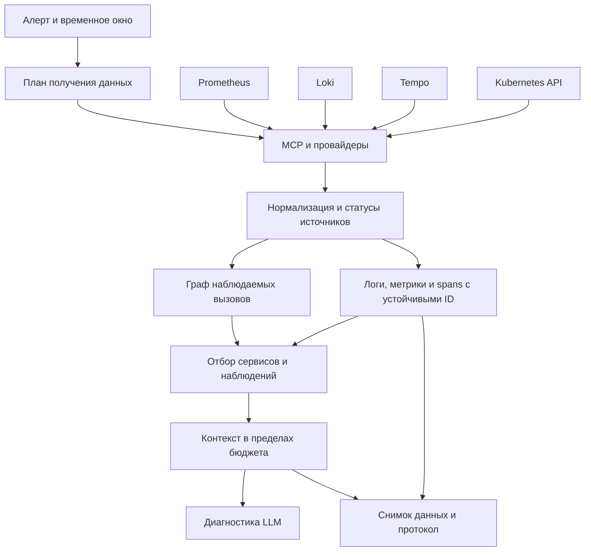

# Формализация задачи диагностики инцидента

Версия 0.1 от 15.11.2026. Пункт 4.2, рабочая версия для обсуждения. См. [алгоритмы](diagnostic-algorithms.md) и [методику оценки](../evaluation/methodology.md).

## Задача и границы

Система получает алерт, собирает телеметрию и связи сервисов, ранжирует гипотезы о проблемном сервисе и причине. Гипотезы ссылаются на наблюдения. Система предлагает проверки и действия по устранению; выполняет их инженер.

Первая версия рассматривает один инициирующий сбой в Kubernetes. Его симптомы могут затрагивать несколько сервисов. Независимые одновременные причины оставлены на будущее. Источники могут содержать неполные данные или быть недоступны.

Инцидент: `I = (id, t_alert, t_received, labels, description, S_alert)`. `t_alert` означает время срабатывания, `t_received` время получения, `S_alert` сервисы, определённые по меткам. Если сервис определить не удалось, это указывается явно.

Окно диагностики: `W = [t_alert - Δ_before, t_alert + Δ_after]`. В историческом эксперименте оно фиксировано. Онлайн правая граница не превышает время начала расследования; ожидание будущих данных требует отдельного режима. Период нормы `W_base` хранится отдельно и заканчивается до предполагаемого начала сбоя.

Результат: `R = (status, H, limitations, stop_reason)`. Список `H = [h1, …, hk]` ранжирует модель; он может быть пустым. Эталонные сервис и механизм сбоя доступны только при оценке.

## Модели данных

Общие поля: `evidence_id`, `source_id`, временные поля, `raw_ref`, сведения о преобразовании. При наличии добавляются `source_record_id` и `service_key`. `evidence_id` устойчив внутри снимка и не зависит от порядка записей. Для агрегата сохраняются запрос, окно, функция и ссылки на исходный набор. Ссылка может вести в снимок; внешний URL необязателен.

| Объект | Содержательные поля |
| --- | --- |
| Лог | timestamp, severity, message, attributes, trace_id, span_id, request_id |
| Метрика | имя, единица, labels, тип, временной ряд или агрегат, шаг и границы интервалов |
| Span | trace_id, span_id, parent_span_id, начало, длительность, статус, ресурс и атрибуты |
| Сервис | cluster, namespace, service, известные workload/pod и период действия соответствия |
| Связь | caller, callee, период наблюдения, число вызовов, ошибки, длительности, ссылки на трассы |
| Результат запроса | source_id, параметры, время выполнения, status, полнота, данные, ограничения |

Статусы: `ok`, `empty`, `partial`, `unavailable`, `timeout`, `invalid_query`, `not_captured`. `empty` означает успешный запрос без записей, `not_captured` отсутствие покрытия в снимке. Недоступность источника не подтверждает нормальную работу сервиса.

Идентификатор: `service_key = (cluster, namespace, service)`. Конфигурация и обнаружение ресурсов сопоставляют `service.name`, метки Prometheus и Kubernetes Service/workload/pod с учётом времени. Несопоставленная запись сохраняет исходные метки и `service_key = null`. Одинаковые имена разных namespace и кластеров не объединяются.

## Нормализация и происхождение

1. Время приводится к UTC с сохранением исходного значения и точности. Известное смещение часов учитывается явно; точного совпадения timestamps для связи событий не требуется.
2. Единицы метрик приводятся к принятой единице конкретной метрики. Counter анализируется через прирост или rate с учётом сброса, gauge через значение и распределение. Несопоставимые единицы и разные наборы labels не смешиваются.
3. Уровни логирования сопоставляются общей шкале. Сообщение и исходные атрибуты сохраняются; неизвестная severity остаётся неизвестной.
4. Связь событий по trace/span ID считается точной идентификационной связью. Совпадение сервиса и времени является временной корреляцией, а не доказанной причинной связью.
5. Повторы при пагинации удаляются по исходному ID или ключу источника и содержимого. Разные реальные одинаковые сообщения объединяются только в агрегат с количеством и диапазоном времени.
6. Усечённые, агрегированные и несопоставленные данные получают соответствующие признаки; исходные данные сохраняются вне контекста модели. Нормализация не дописывает отсутствующие наблюдения.

## Граф зависимостей

`G_W = (V, E_W)`: вершины обозначают сервисы, ребро `u → v` наблюдавшийся вызов из `u` в `v`. Рёбра строятся по parent-child связям клиентских/серверных spans и атрибутам удалённого сервиса. Правило извлечения сохраняется. Внешняя зависимость может быть отдельной вершиной с признаком внешнего ресурса.

Ребро хранит период наблюдения и покрытие трассировок. Граф `W_base` может дополнять граф `W`, сохраняя происхождение рёбер. Sampling и потеря трасс могут скрыть вызовы. Kubernetes API показывает состав ресурсов, но не подтверждает фактические вызовы.

`N_r(S)` содержит сервисы не дальше `r` рёбер от `S` при обходе в обе стороны. Направления сохраняются: upstream показывает возможное распространение симптома, downstream зависимость с возможной причиной. Обход ограничен namespace, разрешённой областью и числом сервисов.

## Подготовка контекста

Провайдеры Prometheus, Loki, Tempo и Kubernetes получают данные через MCP. Приложение задаёт порядок и лимиты; MCP-сервер проверяет запросы и нормализует ответы. При однократной диагностике приложение вызывает MCP до LLM; модель не выбирает инструменты.

По меткам алерта и ограниченному запросу топологии строится `S0 = S_alert ∪ N_r(S_alert)`, затем собирается телеметрия этих сервисов. Если граф или сервис неизвестен, используется ограниченный набор из конфигурации с отметкой о неполноте. Полный опрос кластера не подставляется автоматически.

Источники фильтруют данные по времени, сервисам и разрешённым labels. Локально удаляются повторы, строятся агрегаты и приоритеты. Первыми отбираются сервис алерта, ошибки, медленные spans, отклонения метрик от `W_base` и связанные логи. Сохраняются окружение ошибок, цепочки вызовов и часть нормальных наблюдений.

Упаковка детерминирована и версионируется. Сначала включаются обязательные метаданные и ограничения, затем записи по квотам типов и сервисов. Внутри квоты действует сортировка по приоритету, времени и ID. Свободная квота перераспределяется в заданном порядке. Сохраняются числа записей до и после отбора. Агрегат или усечение помечаются; дополнительная LLM не используется.

Внутри квоты кортеж `(is_alert_service, is_abnormal, has_incident_trace_link, -graph_distance, timestamp)` сортируется лексикографически по убыванию. Равенство разрешается по возрастанию `evidence_id`. Для `is_abnormal` используются WARN/ERROR/FATAL у log, ошибка или превышение порога длительности у span, абсолютный порог либо отклонение от baseline у метрики. Неизвестное отклонение помечается отдельно. Метрики, формула, пороги и квоты выбираются на пилоте и фиксируются для итоговых парных запусков. При коротком baseline отклонение не вычисляется; причина сохраняется.

Упаковщик добавляет целые записи/агрегаты в этом порядке до квот и `C_max`. Пропуск слишком большой записи объясняется в протоколе. Свободные квоты начального контекста перераспределяются в порядке «метрики, трассы, логи». На следующих шагах сначала выделяется квота новым проверкам. Если обязательные метаданные и схема не помещаются, вызов отменяется. При фиксированной конфигурации отбор однозначен; числа уточняются на пилоте.

`C = (I, W, W_base, G_local, E_selected, source_statuses, selection_manifest, instructions)`. Manifest содержит переданные ID, преобразования, усечения и причины отбора. Исходный архив вне выбранного контекста модели недоступен.

## Гипотезы и рекомендации

Гипотеза `h = (id, rank, service, cause, supports, contradicts, missing, recommendations)`. `supports` и `contradicts` содержат ID наблюдений и объяснение связи с утверждением; `missing` указывает, чего не хватает для проверки. Рекомендация имеет тип `verify` или `remediate`, связана с гипотезой и содержит действие, ожидаемый результат проверки или предпосылку применения.

Ранг отражает вывод модели, а не измеренную вероятность. Числовой confidence не служит мерой достоверности или условием остановки. Система проверяет схему и ссылки на переданные наблюдения. Инженер оценивает поддержку гипотез и правильность причины.

## Ограничения затрат

Лимиты запуска: время `T_max`, LLM-вызовы `L_max`, запросы данных `Q_max`, шаги `K_max`, контекст вызова `C_max`, суммарные токены `B_total`, записи и байты ответа источника. В `Q_max` входят страницы и повторы, в `L_max` все обращения, включая ошибки. Время измеряется монотонными часами от начала сбора до сохранения результата.

Перед вызовом проверяются `tokens(prompt) + reserved_output ≤ model_window` и остаток общего бюджета. Повторно переданная история снова учитывается во входных токенах. Фактический usage API хранится отдельно от оценки токенизатора. Неизвестный usage при сетевой ошибке не заменяется нулём.

Предложение для пилота: `Δ_before = 10 мин`, `Δ_after = 0`, `W_base` за 10 минут до окна, `r = 1`, `K_max = 4`. Для пошаговой стратегии `L_max = 5`, один вызов зарезервирован под итог; для однократной `L_max = 1`. После пилота выбираются `C_max`, `B_total`, `Q_max` и `T_max`. Эти параметры ещё не измерены и не согласованы.

## Схема подготовки данных

Сначала запрашиваются каталог и топология, затем телеметрия начального набора сервисов. По трассам уточняются граф и отбор. Порядок запросов описан в алгоритмах.

## Соответствие пункту 4.2

| Требование задания | Результат |
| --- | --- |
| Постановка задачи | Вход `I`, окно `W`, результат `R`, область применения |
| Модели телеметрии | Общие поля происхождения и отдельные модели логов, метрик, spans |
| Граф сервисов | `G_W`, направление рёбер, построение и ограничения покрытия |
| Нормализация | Время, сервисы, единицы, связи, повторы и неполнота |
| Критерии качества | [Методика с определениями и шкалами](../evaluation/methodology.md) |
| Вычислительные ограничения | Лимиты времени, вызовов, контекста и совокупных токенов |
