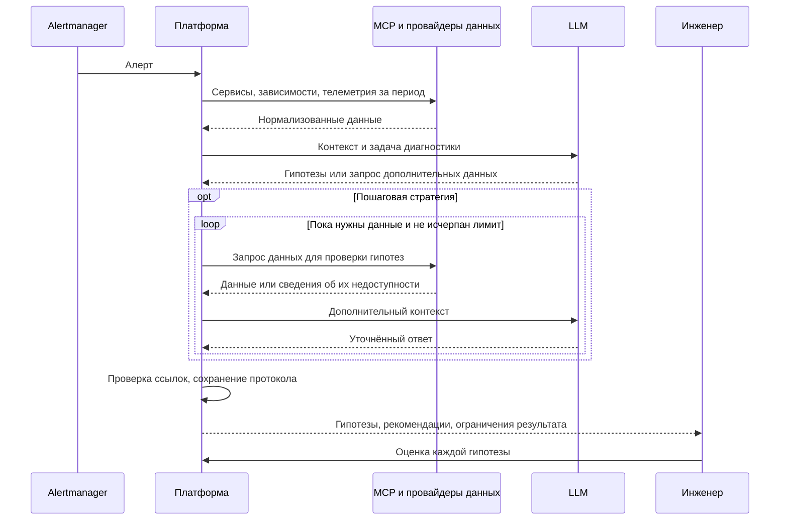

# Заметки по ВКР

Плахотников Владимир Александрович, 5130903/30302

Рабочая концепция. Нормализация и методика оценки требуют проверки на стенде.

## 1. Какие данные поступают и откуда?

Первая среда: Kubernetes.

| Входные данные | Источник |
| --- | --- |
| Алерт: событие, время, метки | Alertmanager |
| Логи | Loki |
| Метрики | Prometheus |
| Трассировки | Tempo |
| Сервисы и их экземпляры | Kubernetes API |
| Граф наблюдаемых вызовов | Строится по трассировкам; сохраняется период наблюдения |

Источники подключаются через заменяемые провайдеры: `LogsProvider`, `LokiLogsProvider` и аналогичные интерфейсы для остальных данных. Доступ через MCP. У каждого компонента своя конфигурация; поддерживаются несколько подключений одного типа. Состав инструментов MCP ещё не определён.

## 2. Нужна ли нормализация и как её проводить?

Да. Преобразование выполняется в адаптерах источников.

| Что нормализовать | Правило |
| --- | --- |
| Время | Единый формат и UTC; исходное время сохраняется |
| Имена сервисов | Общий идентификатор: кластер, namespace, сервис; соответствия задаются конфигурацией |
| Связи между записями | Сохранение trace ID и request ID, если они доступны |
| Происхождение данных | Источник, идентификатор и исходная запись |
| Специфичные поля | Единицы измерения метрик, период наблюдения связей |

Типы логов, метрик и трассировок остаются раздельными. Неизвестные сервисы и связи отмечаются явно. Точные схемы и правила сопоставления проверяются на стенде; граф может быть неполным.

## 3. Как задаются стратегии?

| Уровень | Возможности |
| --- | --- |
| Готовые стратегии | Реализованы в коде, выбираются пользователем |
| Настройки запуска | LLM, источники, временное окно, лимиты времени, запросов и контекста |
| Новая стратегия | Реализация общего интерфейса в коде |
| Новый источник | Новый провайдер без изменения логики диагностики |

Визуальный конструктор алгоритмов в первую версию не входит.

## 4. Какие стратегии дают компромисс качества и времени?

| Стратегия | Работа с данными | Ожидаемый компромисс |
| --- | --- | --- |
| Однократная | Подготовка контекста и один запрос к LLM | Меньше обращений к LLM, но выбранных данных может не хватить |
| Пошаговая | Дополнительные запросы по гипотезам и графу зависимостей | Возможность уточнить причину ценой дополнительных запросов и времени |

Выбор проверяется экспериментально: качество при разных лимитах времени, шагов и контекста. Преимущество какой-либо стратегии заранее не установлено.

### Последовательность расследования

Участники схемы обозначают роли компонентов, а не отдельные сервисы развёртывания.

Исправления выполняет инженер. При недостатке данных результат сохраняется с соответствующей отметкой.

## 5. Что считать качеством и как оценивать?

Стенд: OpenTelemetry Demo, воспроизводимые неисправности с известными причинами.

| Показатель | Критерий |
| --- | --- |
| Проблемный сервис | Доля запусков с правильным сервисом в основной гипотезе |
| Причина | Доля запусков, где основная гипотеза объясняет внесённую неисправность, а не только симптом |
| Рекомендации | Предварительная шкала: 0: неверные; 1: помогают продолжить проверку; 2: содержат подходящее действие для известной причины |
| Обоснованность | Ссылки существуют, указанные данные поддерживают гипотезу |
| Затраты | Время от начала сбора данных до результата, число запросов, объём контекста |
| Незавершённые запуски | Доля ошибок и запусков без ответа |

Существование ссылок проверяется программно; причина, рекомендации и их обоснованность оцениваются по описанию сценария. Шкала требует согласования до эксперимента. Выполнение рекомендаций в проверку не включено.

Условия сравнения: одинаковые инциденты, модель, параметры LLM и доступные источники; повторные запуски. Сценарии настройки и итоговой проверки разделены, эталонные причины в LLM не передаются.
