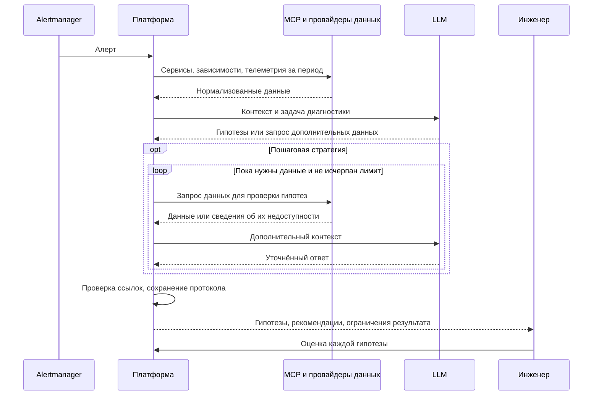
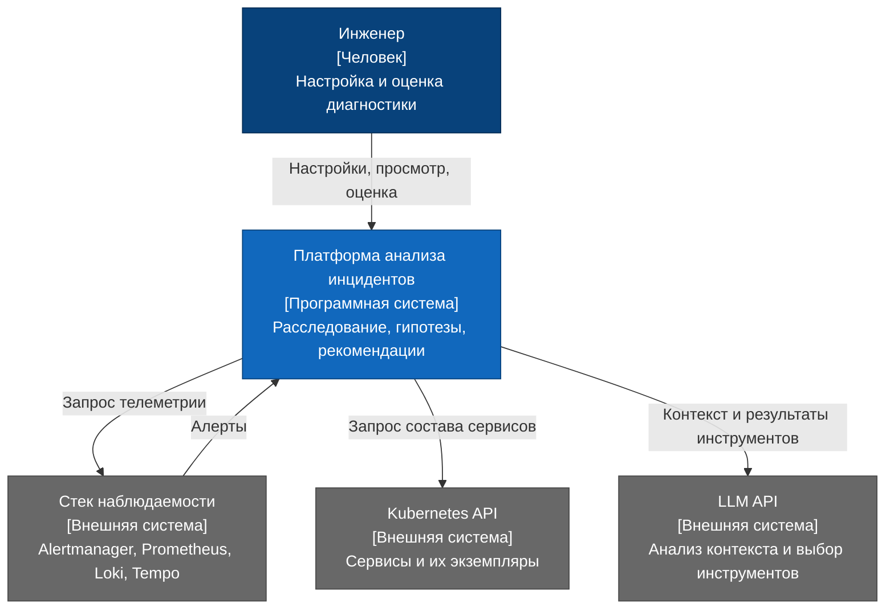
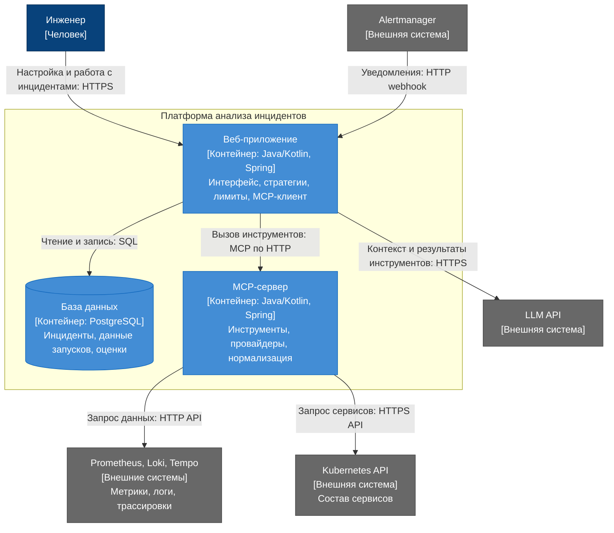

# Заметки по ВКР

Плахотников Владимир Александрович, 5130903/30302

## 1. Данные и источники

Первая среда: Kubernetes.

| Входные данные | Источник |
| --- | --- |
| Алерт: событие, время, метки | Alertmanager |
| Логи | Loki |
| Метрики | Prometheus |
| Трассировки | Tempo |
| Сервисы и их экземпляры | Kubernetes API |
| Граф наблюдаемых вызовов | Строится по трассировкам; сохраняется период наблюдения |

Источники подключаются через заменяемые провайдеры: `LogsProvider`, `LokiLogsProvider` и аналогичные интерфейсы для остальных данных. Доступ через MCP. У каждого компонента своя конфигурация; поддерживаются несколько подключений одного типа.

## 2. Нормализация данных

Адаптеры приводят данные разных источников к общему формату.

| Что нормализовать | Правило |
| --- | --- |
| Время | Единый формат и UTC; исходное время сохраняется |
| Имена сервисов | Общий идентификатор: кластер, namespace, сервис; соответствия задаются конфигурацией |
| Связи между записями | Сохранение trace ID и request ID, если они доступны |
| Происхождение данных | Источник, идентификатор и исходная запись |
| Специфичные поля | Единицы измерения метрик, период наблюдения связей |

У логов, метрик и трассировок свои форматы. Если сервис или связь не удалось определить, это отмечается в данных. На стенде нужно проверить, правильно ли сопоставляются записи из разных источников. Часть вызовов может не попасть в трассировки, поэтому в графе будут видны не все связи.

## 3. Настройка и добавление стратегий

| Уровень | Возможности |
| --- | --- |
| Готовые стратегии | Реализованы в коде, выбираются пользователем |
| Настройки запуска | LLM, источники, временное окно, лимиты времени, запросов и контекста |
| Новая стратегия | Реализация общего интерфейса в коде |
| Новый источник | Новый провайдер без изменения логики диагностики |

Визуальный конструктор алгоритмов в первую версию не входит.

## 4. Сравнение стратегий

| Стратегия | Как работает | Плюсы и ограничения |
| --- | --- | --- |
| Однократная | Подготовка контекста и один запрос к LLM | Меньше обращений к LLM, но выбранных данных может не хватить |
| Пошаговая | Дополнительные запросы по гипотезам и графу зависимостей | Дополнительные данные могут помочь найти причину, но их сбор и анализ занимают время |

Стратегии сравниваются при разных лимитах времени, шагов и контекста. Какая точнее и быстрее, покажут эксперименты.

### Последовательность расследования

На схеме показаны компоненты приложения. Запускать каждый отдельным сервисом не обязательно.

Исправления выполняет инженер. Если данных не хватает, это указывается в результате.

## 5. Оценка результатов

На стенде OpenTelemetry Demo создаются сбои с известными причинами.

| Показатель | Критерий |
| --- | --- |
| Проблемный сервис | Доля запусков с правильным сервисом в основной гипотезе |
| Причина | Доля запусков, где основная гипотеза объясняет внесённую неисправность, а не только симптом |
| Рекомендации | Предварительная шкала: 0: неверные; 1: помогают продолжить проверку; 2: содержат подходящее действие для известной причины |
| Обоснованность | Ссылки существуют, указанные данные поддерживают гипотезу |
| Затраты | Время от начала сбора данных до результата, число запросов, объём контекста |
| Незавершённые запуски | Доля ошибок и запусков без ответа |

Приложение проверяет, существуют ли записи, на которые ссылается модель. Причину и рекомендации оценивает инженер по описанию сбоя и собранным данным. Шкалу нужно согласовать до эксперимента. Рекомендации на стенде не выполняются.

Обе стратегии проверяются на одинаковых инцидентах, с одной моделью, её настройками и доступом к одним источникам. Каждый запуск повторяется несколько раз. Для настройки и итоговой проверки используются разные сценарии. Модель получает телеметрию без описания внесённой неисправности.

## 6. Архитектура

### C4: контекст системы

### C4: контейнеры

Вариант с отдельным MCP-сервером. Веб-интерфейс входит в приложение; провайдеры входят в MCP-сервер.

LLM возвращает запрос инструмента приложению. Приложение вызывает MCP-сервер и передаёт результат обратно модели. Доступ к Loki, Prometheus, Tempo и Kubernetes находится у провайдеров.

`LogsProvider` и `LokiLogsProvider` являются внутренними модулями MCP-сервера. Замена реализации или добавление подключения не меняют алгоритм расследования.
